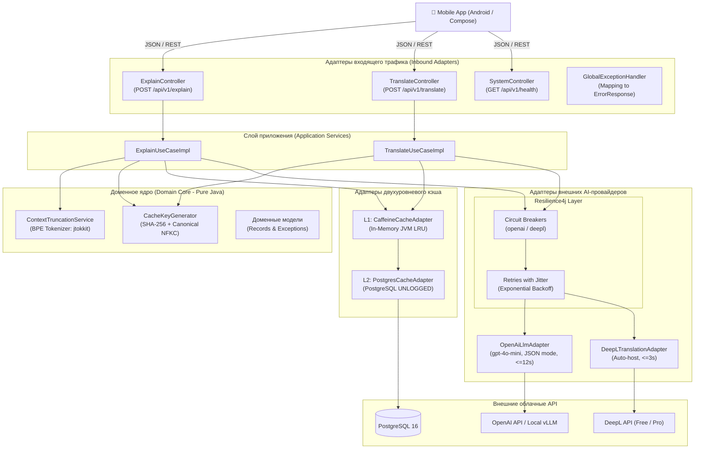
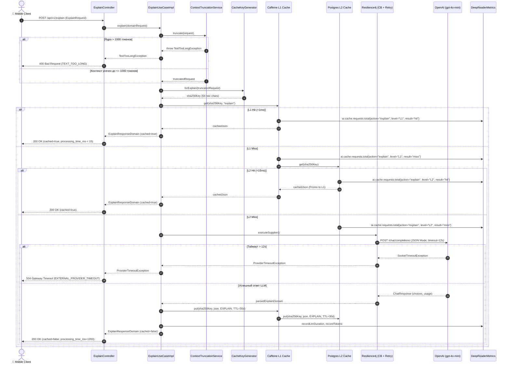
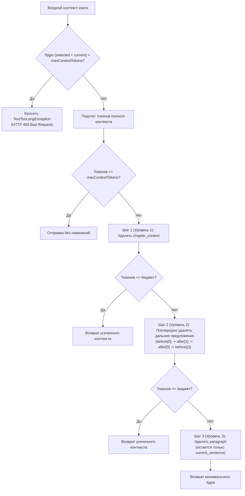

# 📐 Системный дизайн и архитектура сервиса

Сервис **Deep Reader Backend** спроектирован по каноническим принципам **Гексагональной архитектуры (Ports & Adapters)** и методологии **The Twelve-Factor App**.

Главная цель архитектуры — полная независимость ядра бизнес-логики от внешних фреймворков, баз данных и провайдеров искусственного интеллекта, а также обеспечение максимальной надежности (High Availability) при интеграции с нестабильными внешними облачными API (OpenAI, DeepL).

---

## 1. Общая компонентная диаграмма (Mermaid Flowchart)



---

## 2. Sequence-диаграмма обработки запроса `POST /api/v1/explain`

Диаграмма иллюстрирует сквозной жизненный цикл обработки запроса литературного анализа: от проверки ограничений токенов до двухуровневого кэширования и вызова нейросети.



---

## 3. Алгоритм ступенчатой обрезки контекста (`ContextTruncationService`)

Для оптимизации затрат на токены и предотвращения переполнения контекстного окна модели установлен жесткий лимит: **не более 1000 BPE-токенов** на суммарный промпт (FROZEN SPEC: [`docs/specs/03_ai_logic.md`](../specs/03_ai_logic.md) §1).

Токенизация выполняется локально на CPU без внешних вызовов с использованием библиотеки `com.knuddels:jtokkit` (кодировка `O200K_BASE` для моделей семейства GPT-4o / `CL100K_BASE`). При вычислении доступного бюджета для литературного контекста сервис автоматически вычитает объем токенов `PromptTemplates.SYSTEM_PROMPT`.



### Пошаговая деградация:
- **Неприкосновенное ядро (Inviolable Core):** `selected_text` и `current_sentence`. Это смысловой центр запроса. Если даже они превышают бюджет токенов, запрос немедленно отклоняется с ошибкой `TEXT_TOO_LONG`.
- **Шаг 1 (Уровень 1):** Удаление заголовка и аннотации главы (`chapter_context`).
- **Шаг 2 (Уровень 2):** Последовательное отбрасывание наиболее удаленных предложений видимой области в строгом порядке:
  1. `sentences_before[0]` (если передано 2 предложения до)
  2. `sentences_after[1]` (если передано 2 предложения после)
  3. `sentences_after[0]`
  4. `sentences_before[1]`
- **Шаг 3 (Уровень 3):** Удаление окружающего текста абзаца (`paragraph`). Остаётся гарантированно укладывающийся в бюджет срез (неприкосновенное ядро).

---

## 4. Политики отказоустойчивости (Resilience4j)

Конфигурация задана в [`ResilienceConfig`](../../src/main/java/com/teamfourpixels/deepreaderbackend/infrastructure/config/ResilienceConfig.java) и [application.yaml](../../src/main/resources/application.yaml).

| Параметр политики | OpenAI (`gpt-4o-mini`) | DeepL API (`translate`) | Обоснование |
| :--- | :--- | :--- | :--- |
| **Строгий HTTP-таймаут** | **12 секунд** | **3 секунды** | Предотвращает зависание потоков сервлета Tomcat. |
| **Размер скользящего окна (Circuit Breaker)** | 10 вызовов | 10 вызовов | Быстрая реакция на деградацию провайдера. |
| **Минимум вызовов для анализа** | 5 | 5 | Защита от ложных срабатываний при прогреве. |
| **Порог процента сбоев (Failure Rate)** | 50% | 50% | Размыкание цепи при половине сбойных ответов. |
| **Время в состоянии OPEN** | **15 секунд** | **10 секунд** | Пауза для восстановления внешнего сервиса. |
| **Пробных вызовов в HALF_OPEN** | 3 | 3 | Плавная проверка доступности сервиса. |
| **Количество попыток Retry** | 2 попытки (1 повтор) | 3 попытки (2 повтора) | Перевод дешевле и быстрее, допускает больше повторов. |
| **Базовая задержка Retry** | 500 мс | 300 мс | Начальный интервал перед повторным вызовом. |
| **Алгоритм задержки Retry** | Экспоненциальный с jitter (`1.5x`, случайность `0.5`) | Экспоненциальный с jitter (`1.5x`, случайность `0.5`) | **Randomized Jitter** исключает «эффект набегающей толпы» (Thundering Herd) на провайдера. |
| **Исключения для Circuit Breaker** | `ExternalProviderException`, `ProviderTimeoutException`, `ResourceAccessException` | `ExternalProviderException`, `ProviderTimeoutException`, `ResourceAccessException` | Системные и сетевые сбои учитываются в метриках надежности. |
| **Игнорируемые исключения** | `EmptyAiResponseException` (422) | — | Ошибки валидации контента не считаются сбоем канала. |

---

## 5. Карта Java-пакетов (Hexagonal Architecture)

```text
com.teamfourpixels.deepreaderbackend/
├── domain/                                # 1. ЧИСТОЕ ДОМЕННОЕ ЯДРО (POJO, без внешних зависимостей)
│   ├── exception/                         # Доменные исключения (TextTooLongException, EmptyAiResponseException, ...)
│   ├── model/                             # Доменные модели (ExplainRequestDomain, PhenomenonType, StylisticColoring, ...)
│   └── service/                           # Сервисы ядра:
│       ├── CacheKeyGenerator.java         # Каноническая нормализация текста и SHA-256 хэширование
│       └── ContextTruncationService.java  # Ступенчатая обрезка контекста по BPE-токенам (jtokkit)
│
├── port/                                  # 2. ПОРТЫ (Контракты взаимодействия ядра с миром)
│   ├── in/                                # Входящие порты (Use Cases):
│   │   ├── ExplainUseCase.java            # Порт сценария литературного анализа
│   │   └── TranslateUseCase.java          # Порт сценария перевода текста
│   └── out/                               # Исходящие порты (SPI):
│       ├── CachePort.java                 # Контракт двухуровневого кэша (get, put, evict)
│       ├── LlmPort.java                   # Контракт взаимодействия с нейросетью
│       └── TranslationPort.java           # Контракт взаимодействия с сервисом перевода
│
├── application/                           # 3. СЛОЙ ПРИЛОЖЕНИЯ (Оркестрация сценариев)
│   ├── ExplainUseCaseImpl.java            # Оркестрация: Truncation -> L1/L2 Cache -> LLM -> Cache Put
│   └── TranslateUseCaseImpl.java          # Оркестрация: L1/L2 Cache -> DeepL -> Cache Put
│
├── adapter/                               # 4. АДАПТЕРЫ (Реализация портов под технологии)
│   ├── in/web/                            # Входящие REST-адаптеры:
│   │   ├── ExplainController.java         # Контроллер POST /api/v1/explain
│   │   ├── TranslateController.java       # Контроллер POST /api/v1/translate
│   │   ├── SystemController.java          # Контроллер GET /api/v1/health
│   │   ├── GlobalExceptionHandler.java    # Централизованный перехват ошибок -> ErrorResponse
│   │   └── dto/                           # REST DTO (валидация Jakarta, поля в snake_case)
│   └── out/                               # Исходящие адаптеры:
│       ├── cache/                         # Адаптеры кэша:
│       │   ├── CaffeineCacheAdapter.java  # L1 In-Memory LRU кэш (@Primary)
│       │   └── PostgresCacheAdapter.java  # L2 UNLOGGED PostgreSQL кэш + @Scheduled очистка
│       ├── llm/                           # LLM-адаптеры:
│       │   ├── OpenAiLlmAdapter.java      # Адаптер к OpenAI API (gpt-4o-mini, JSON Mode, CB+Retry)
│       │   ├── MockLlmAdapter.java        # Локальная заглушка для тестов и CI/CD
│       │   └── PromptTemplates.java       # Системные и пользовательские промпты (Prompt Version v1.0)
│       └── translate/                     # Адаптеры перевода:
│           ├── DeepLTranslationAdapter.java # Адаптер к DeepL API (CB+Retry, автоопределение хоста)
│           └── MockTranslationAdapter.java  # Локальная заглушка перевода
│
└── infrastructure/                        # 5. ИНФРАСТРУКТУРА И ТЕХНИЧЕСКИЕ СЕРВИСЫ
    ├── config/                            # Spring Configuration:
    │   ├── AiProperties.java              # @ConfigurationProperties("app.ai")
    │   ├── ResilienceConfig.java          # Бины CircuitBreaker и Retry для Resilience4j
    │   └── RestClientConfig.java          # Настройка HTTP-клиентов и таймаутов
    └── metrics/                           # Наблюдаемость:
        └── DeepReaderMetrics.java         # Кастомные метрики Micrometer (SLO, задержки, токены, кэш)
```
