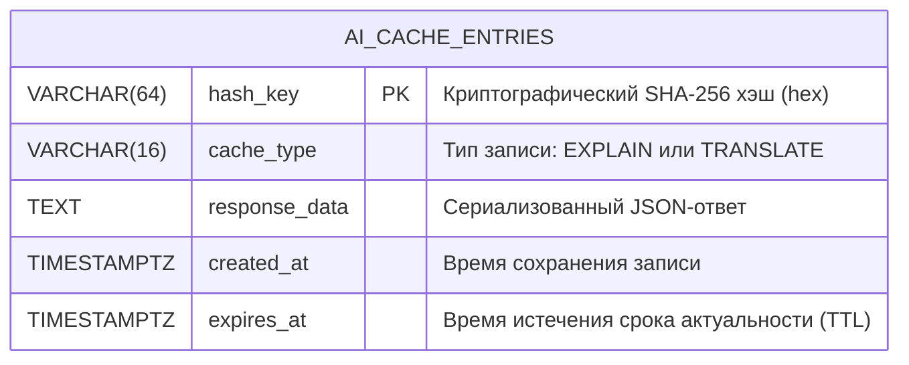
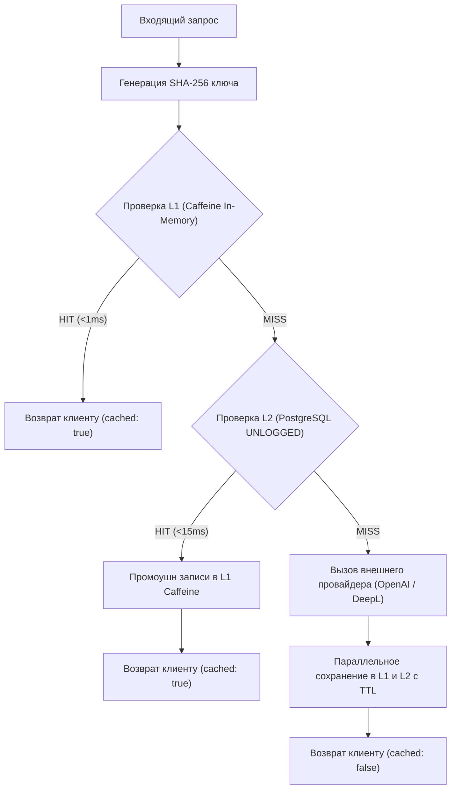

# 🗄 Архитектура базы данных и двухуровневого кэша

В данном документе описывается концепция хранения данных, схема таблицы кэша, выбор технологий и алгоритмы инвалидации сервиса **Deep Reader Backend**.

---

## 1. Zero-Knowledge архитектура и приватность

Сервис Deep Reader Backend изначально спроектирован в парадигме **Zero-Knowledge** и **Data Minimization (GDPR Art. 5)**:
- **Никакого хранения книг:** Бэкенд **никогда** не сохраняет в реляционной базе данных книги, главы, абзацы или историю чтения пользователей.
- **Авторское право (Copyright Compliance):** Отсутствие персистентного хранения текстов произведений исключает юридические риски нарушения авторских и смежных прав при работе с художественной литературой.
- **Хранение только результатов вычислений:** В базе данных сохраняются исключительно анонимизированные криптографические хэши (SHA-256) запросов и сериализованные JSON-результаты разборов и переводов со строгим сроком жизни (TTL).
- **Изоляция контекстов:** Хэш-ключ каждого запроса включает идентификатор издания (`book_id`). Это гарантирует, что контекст одного произведения никогда не смешается с другим.

---

## 2. Схема базы данных (таблица `ai_cache_entries`)

Все данные L2-кэша хранятся в оптимизированной таблице `ai_cache_entries`.

### 2.1. ER-диаграмма (Mermaid)



### 2.2. Спецификация колонок

| Колонка | Тип данных | Nullable | Описание |
| :--- | :--- | :---: | :--- |
| `hash_key` | `VARCHAR(64)` | **НЕТ** | **PRIMARY KEY**. 64-символьная hex-строка SHA-256 хэша канонизированного запроса. |
| `cache_type` | `VARCHAR(16)` | **НЕТ** | Тип кэшируемой операции (`EXPLAIN` или `TRANSLATE`). |
| `response_data` | `TEXT` | **НЕТ** | Сериализованное тело ответа (`ExplainResponseDomain` или `TranslationCacheEntry`). |
| `created_at` | `TIMESTAMPTZ` | **НЕТ** | Временная метка создания записи (по умолчанию `CURRENT_TIMESTAMP`). |
| `expires_at` | `TIMESTAMPTZ` | **НЕТ** | Момент времени, после которого запись считается недействительной. |

### 2.3. Индексы таблицы

1. **`PRIMARY KEY (hash_key)`**: B-tree индекс для моментального точечного поиска значения по O(1) задержке (<1 мс).
2. **`idx_ai_cache_expires (expires_at)`**: Отдельный B-tree индекс для быстрого поиска и фонового удаления просроченных записей планировщиком без полного сканирования таблицы (`Seq Scan`).

---

## 3. Выбор PostgreSQL `UNLOGGED` vs Redis

В классических архитектурах в качестве распределённого кэша часто выбирают Redis. В Deep Reader Backend было принято архитектурное решение использовать **UNLOGGED таблицу в PostgreSQL** в сочетании с **L1 Caffeine в памяти JVM**.

### Преимущества UNLOGGED PostgreSQL:
1. **Отсутствие накладных расходов на WAL (Write-Ahead Logging):**
   UNLOGGED таблицы в PostgreSQL не пишут изменения в журнал предзаписи (WAL). Это увеличивает скорость операций записи (`INSERT`/`UPDATE`) в 3–5 раз, приближая производительность к In-Memory NoSQL базам данных.
2. **Консолидация инфраструктурного стека:**
   Нет необходимости развёртывать, кластеризовать, резервировать и мониторить дополнительный кластер Redis. Достаточно единого надёжного экземпляра PostgreSQL.
3. **Безопасность при аварийном завершении:**
   При сбое питания PostgreSQL автоматически очищает UNLOGGED таблицы при старте. Так как это кэш, потеря данных не является критичной — данные прозрачно восстановятся из вызовов внешних API по мере поступления запросов.
4. **Стандартный SQL и лёгкие миграции:**
   Поддержка транзакций, стандартных миграций через Liquibase и стандартных пулов соединений (HikariCP).

---

## 4. Двухуровневая стратегия кэширования (L1 + L2)



- **L1 In-Memory (Caffeine):**
  - Расположен непосредственно в хипе JVM приложения.
  - Лимит: `app.cache.l1-max-size: 10000` записей (политика вытеснения Window TinyLFU).
  - Срок жизни: `app.cache.l1-ttl-hours: 1` час.
  - Задержка: **< 1 мс**.
- **L2 Персистентный кэш (PostgreSQL UNLOGGED):**
  - Общий кэш между всеми репликами сервиса в кластере Kubernetes.
  - Срок жизни (TTL):
    - `EXPLAIN`: **30 дней**.
    - `TRANSLATE`: **90 дней**.
  - Задержка: **10–15 мс**.

---

## 5. Формулы нормализации и генерации ключей кэша

Для исключения ложных промахов кэша из-за различий в пробелах, типографике или невидимых символах в EPUB применяется трёхэтапная **Каноническая нормализация (Canonical Normalization)**:
1. **Unicode NFKC:** Приведение символов к стандартной совместимой форме (фигурные типографические кавычки `“` `”` заменяются на обычные `"`, длинные тире `—` на `-`, составные глифы соединяются).
2. **Whitespace Collapsing:** Замена любых последовательностей пробелов, табуляций и переводов строк на один пробел: `text.replaceAll("\\s+", " ").strip()`.
3. **Удаление невидимых символов:** Очистка от zero-width spaces (`\u200B`), soft hyphens (`\u00AD`) и управляющих символов ASCII (`[\x00-\x1F\x7F]`).

### Формула для Explain:
```text
key = SHA-256(
    PROMPT_VERSION + ":" +
    BOOK_ID + ":" +
    NORMALIZED(selected_text) + ":" +
    NORMALIZED(context_fingerprint) + ":" +
    target_language.toLowerCase()
)
```
- `PROMPT_VERSION`: текущая версия системного промпта (`"v1.0"`). Позволяет моментально инвалидировать весь кэш при смене инструкций LLM.
- `context_fingerprint`: канонический JSON, собранный из предложений до/после, абзаца и контекста главы.

### Формула для Translate:
```text
key = SHA-256(
    "translate:v1:" +
    NORMALIZED(text) + ":" +
    (source_language != null ? source_language.toLowerCase() : "auto") + ":" +
    target_language.toLowerCase()
)
```

Результирующий хэш представляет собой ровно 64 hex-символа в нижнем регистре (например: `4a5f...3b12`).

---

## 6. Защита от протухания и фоновая очистка

1. **Защита на уровне чтения (Stale-Read Prevention):**
   Запрос на чтение всегда содержит предикат `expires_at > NOW()`:
   ```sql
   SELECT response_data FROM ai_cache_entries WHERE hash_key = ? AND expires_at > NOW()
   ```
   Даже если просроченная запись физически ещё присутствует в таблице, клиент её никогда не получит.

2. **Фоновый сборщик мусора (Scheduled Garbage Collection):**
   В классе `PostgresCacheAdapter` настроена периодическая фоновая задача:
   ```java
   @Scheduled(cron = "0 0 * * * *")
   public void cleanupExpired() {
       jdbc.update("DELETE FROM ai_cache_entries WHERE expires_at < NOW()");
   }
   ```
   Каждый час удаляются все устаревшие строки. Благодаря индексу `idx_ai_cache_expires` операция занимает считанные миллисекунды и не блокирует чтение/запись.

---

## 7. Управление схемой через Liquibase

Схема базы данных находится под полным версионным контролем через **Liquibase**.
- Главный манифест: [`src/main/resources/db/changelog/db.changelog-master.yaml`](../../src/main/resources/db/changelog/db.changelog-master.yaml)
- Миграция создания кэша: [`src/main/resources/db/changelog/changes/V1__create_ai_cache.sql`](../../src/main/resources/db/changelog/changes/V1__create_ai_cache.sql)

```sql
CREATE UNLOGGED TABLE IF NOT EXISTS ai_cache_entries (
    hash_key VARCHAR(64) PRIMARY KEY,
    cache_type VARCHAR(16) NOT NULL,
    response_data TEXT NOT NULL,
    created_at TIMESTAMP WITH TIME ZONE DEFAULT CURRENT_TIMESTAMP,
    expires_at TIMESTAMP WITH TIME ZONE NOT NULL
);

CREATE INDEX IF NOT EXISTS idx_ai_cache_expires ON ai_cache_entries (expires_at);
```
Миграции применяются автоматически при старте приложения (`spring.liquibase.enabled: true`).
