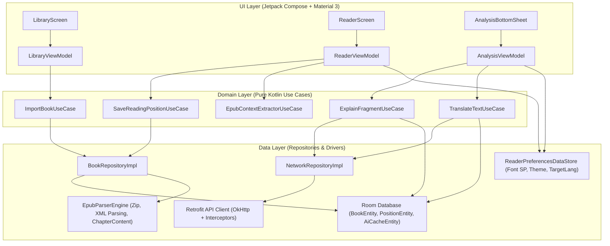
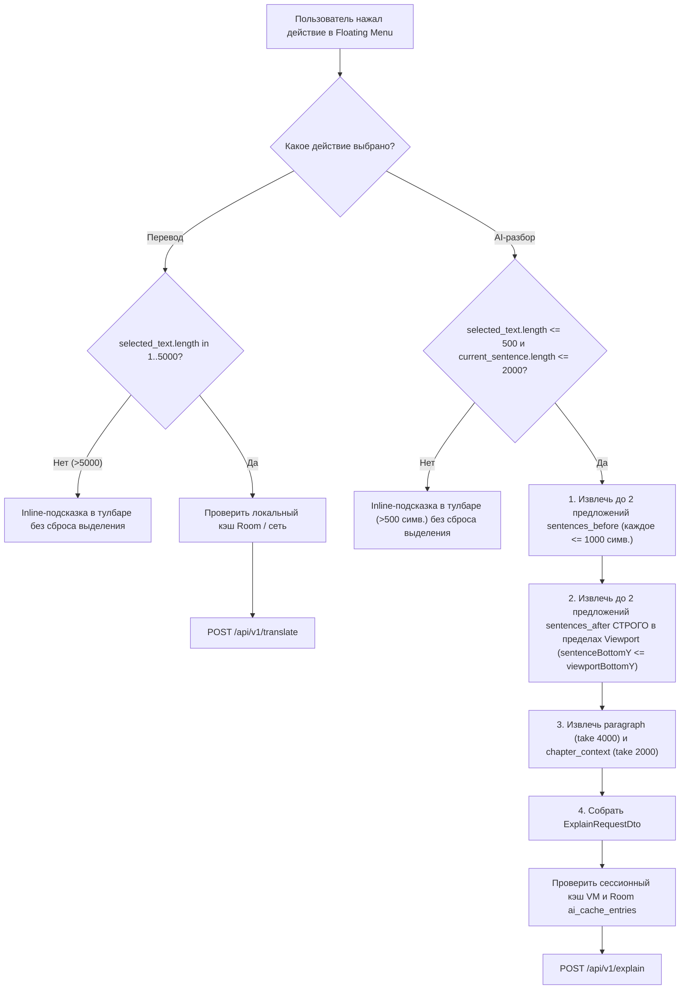

# 📱 OpenSpec: Core MVP Android Reader & AI-Context Engine

**Спецификация:** OpenSpec Android Application (`com.ergin.deepreader`)  
**Версия:** 1.1.0 (FROZEN / Production-Ready Mobile Design)  
**Статус:** Approved  
**Целевая платформа:** Android 8.0+ (API Level 26+), Predictive Back (Android 14+), Edge-to-Edge (Android 15+)  
**Технологический стек:** Kotlin, Jetpack Compose, Material 3, Coroutines / StateFlow, Hilt (DI), Retrofit 2 + Kotlinx Serialization, Room Database, Preferences DataStore, EPUB Parser Engine.  
**Основной ФТЗ-источник:** [`ФТЗ_ Core MVP Android Reader & AI-контекст.md`](../../ФТЗ_%20Core%20MVP%20Android%20Reader%20&%20AI-контекст.md)  
**Бэкенд-контракты:** [`docs/specs/02_openapi.yaml`](../specs/02_openapi.yaml), [`docs/mobile/ANDROID_INTEGRATION_GUIDE.md`](ANDROID_INTEGRATION_GUIDE.md), [`docs/specs/03_ai_logic.md`](../specs/03_ai_logic.md)

---

## 1. Scope & System Boundaries

### 1.1. In-Scope (MVP)
1. **Импорт и хранение EPUB (однопроходный поток):** Выбор EPUB-файлов через Android Storage Access Framework (SAF), потоковая валидация ZIP/OPF структуры и одновременный подсчёт SHA-256 через `DigestInputStream` при копировании во внутреннее хранилище (`context.filesDir`).
2. **Дедупликация файлов и защита метаданных (ФТ-6):**
   - Жёсткая блокировка точных дубликатов по `SHA-256` в Room DB с действием «Открыть существующую».
   - Мягкое неблокирующее предупреждение (ФТ-6.3), если `SHA-256` отличается, но нормализованные `title` и `author` совпадают с уже добавленной книгой.
3. **Движок чтения (Reader Engine):**
   - Парсинг XHTML глав в типизированную модель `ChapterContent -> ParagraphBlock -> SentenceSpan`.
   - Рендеринг строго через `LazyColumn` (запрет `ScrollView` для текста книги) с вертикальной непрерывной прокруткой внутри главы.
   - Отслеживание границ предложений через `TextLayoutResult` и `LayoutCoordinates` видимого Viewport.
   - Навигация по главам (NCX/NAV Spine) с блокировкой переходов за границы первой и последней глав (ФТ-12, ФТ-13).
   - Поддержка тем чтения (**Light / Dark / Sepia**) и масштабирования шрифта (`sp`) без сброса логической позиции.
   - Graceful degradation при повреждённых узлах XHTML/медиа внутри главы (ФТ-33).
4. **Точное сохранение и отказоустойчивое восстановление позиции:** Использование **EPUB CFI (Canonical Fragment Identifier)** с многоуровневой цепочкой fallback (`epubCfi` → `chapterIndex + paragraphIndex + charOffset` → ближайший доступный параграф → начало книги без показа технической ошибки).
5. **Автономность (Offline-First Reader):** 100% работоспособность библиотеки, чтения, прокрутки, переключения глав, смены шрифта и сохранения прогресса без интернета.
6. **Выделение текста & Floating Menu (ФТ-34 – ФТ-40):**
   - Захват выделенного фрагмента и показ кастомного плавающего меню действий (**«Перевод»** / **«AI-разбор»**) с защитой от перекрытия системными инсетами и конфликта с edge-жестом «Назад».
   - Разделение клиентских лимитов длины выделения: до **500 символов** для «AI-разбор» и до **5000 символов** для «Перевод».
7. **Извлечение контекста с защитой от спойлеров (Context Extractor):**
   - Клиентская проверка символьных лимитов OpenAPI (`selected_text` ≤ 500, `current_sentence` ≤ 2000, `paragraph` ≤ 4000, `chapter_context` ≤ 2000, до 2 `sentences_before` ≤ 1000 и до 2 `sentences_after` ≤ 1000).
   - **Strict Spoiler Guardrail (ФТ-67 / ФТ-70):** `sentences_after` включают только предложения, нижняя координата которых фактически находится внутри видимого Viewport на момент выделения.
   - BPE-токенизация (`jtokkit`, лимит 1000 токенов) и 4-уровневое усечение контекста выполняются **исключительно на бэкенде** (`docs/specs/03_ai_logic.md`).
8. **Сетевая интеграция с Proxy Backend & Локальный кэш:**
   - `POST /api/v1/explain` (Интеллектуальный разбор через LLM).
   - `POST /api/v1/translate` (Быстрый перевод через DeepL).
   - `GET /api/v1/health` (Liveness / Readiness проверка).
   - Двухуровневое клиентское кэширование: in-memory кэш `AnalysisViewModel` для мгновенного повторного открытия шторки в рамках сессии (ФТ-61) + таблица `ai_cache_entries` в Room для офлайн-доступа к уже полученным разборам/переводам.
9. **UI Компоненты (Jetpack Compose Material 3 Bottom Sheet):**
   - Сохранение визуального контекста книги (автоподскролл текста над шторкой + цитата `selected_text` внутри `current_sentence` в шапке шторки).
   - Shimmer skeleton во время сетевой загрузки и блокировка повторного запроса (ФТ-46).
   - Адаптивный `FlowRow` для бейджей `phenomenon_type` и `stylistic_coloring` (поддержка масштабирования шрифта до 200%).
   - Защищённый аккордеон при `spoiler_alert == true`.
   - Полная обработка ошибок OpenAPI с отображением `trace_id` и кнопкой Retry.

### 1.2. Out-of-Scope (MVP)
- Полноценный мульти-turn AI-чат по всей книге.
- Генерация иллюстраций или аудиокниг.
- Офлайн LLM-модели и локальные языковые пакеты перевода на устройстве.
- Desktop-reader, браузерное расширение или веб-версия.
- Социальные функции, рекомендации книг и сложная система изучения языка.

---

## 2. Architecture & Component Design

Приложение строится по архитектурным принципам **Clean Architecture + MVI/MVVM (Unidirectional Data Flow)**.



### 2.1. Архитектурное решение Reader Engine (Selection & Viewport Tracking)
Для однозначной реализации ФТ-11 (вертикальный скролл), ФТ-15.1 (EPUB CFI / якоря), ФТ-34 (кастомное меню выделения) и ФТ-67.1 (проверка видимости `sentences_after`) фиксируется следующая модель рендеринга:
- **Структура данных главы (`ChapterContent`):** парсер преобразует XHTML-документ главы в упорядоченный список `ParagraphBlock(paragraphIndex, xhtmlElementId, rawText, sentences: List<SentenceSpan>)`, где каждый `SentenceSpan` хранит диапазон символов `startOffset..endOffset` внутри абзаца и опциональный EPUB CFI префикс.
- **Контейнер рендеринга:** строго `LazyColumn(state = lazyListState)` с устойчивыми ключами `key = { it.paragraphIndex }`. Использование `ScrollView` / `Column(verticalScroll)` запрещено во избежание деградации памяти и фризов на крупных главах.
- **Измерение видимого Viewport (Spoiler Guardrail):**
  - Контейнер читалки фиксирует экранные границы видимой области `viewportBounds: Rect` через `Modifier.onGloballyPositioned`.
  - Каждый видимый `ParagraphBlock` передаёт `TextLayoutResult` из `onTextLayout` вместе со своими глобальными координатами `blockTopY`.
  - Нижняя граница любого предложения `sentenceIndex` вычисляется как `sentenceBottomY = blockTopY + textLayoutResult.getLineBottom(lastLineOfSentence)`.
  - Предложение допускается к попаданию в `sentences_after` **тогда и только тогда**, когда `sentenceBottomY <= viewportBounds.bottom`.

---

## 3. Detailed Functional Specifications (FT Mapping)

### 3.1. Модуль библиотеки и добавления книг (ФТ-1 – ФТ-6, ФТ-30, ФТ-31)

#### FT-1.1: Модель хранения книги (`BookEntity`)
```kotlin
@Entity(tableName = "books")
data class BookEntity(
    @PrimaryKey val bookId: String, // SHA-256 исходного EPUB-файла
    val title: String,
    val author: String?,
    val coverPath: String?,
    val localFilePath: String,      // Путь в context.filesDir/books/{bookId}.epub
    val fileSizeBytes: Long,
    val totalChapters: Int,
    val addedAt: Long = System.currentTimeMillis(),
    val lastOpenedAt: Long? = null
)
```

#### FT-1.2: Выбор, однопроходное копирование, SHA-256 и дедупликация (ФТ-1 – ФТ-6)
- **Системное действие:** Вызов Android Storage Access Framework (`ActivityResultContracts.OpenDocument()`) с MIME-типами `arrayOf("application/epub+zip")`. При отмене выбора (ФТ-4) состояние библиотеки и БД не изменяются.
- **Однопроходный импорт через `DigestInputStream`:** Во избежание двойного чтения внешнего файла через SAF поток `Uri` копируется во временный staging-файл `filesDir/staging/{uuid}.epub` с одновременным расчётом SHA-256:
  ```kotlin
  suspend fun copyAndHashEpub(
      context: Context,
      uri: Uri,
      stagingFile: File
  ): String = withContext(Dispatchers.IO) {
      val digest = MessageDigest.getInstance("SHA-256")
      context.contentResolver.openInputStream(uri)?.use { rawStream ->
          DigestInputStream(rawStream, digest).use { digestStream ->
              FileOutputStream(stagingFile).use { output ->
                  digestStream.copyTo(output, bufferSize = 8192)
              }
          }
      } ?: throw IOException("Unable to open input stream for URI")
      digest.digest().joinToString("") { "%02x".format(it) }
  }
  ```
- **Валидация контейнера и ошибок I/O (ФТ-3):**
  - Перед записью в БД staging-файл проверяется как ZIP-архив на наличие `META-INF/container.xml` и корневого файла `.opf`.
  - Если файл повреждён или не является EPUB — staging-файл удаляется, отображается `Snackbar` (*«Формат файла не поддерживается»*) с возвратом в библиотеку.
  - При нехватке места на устройстве (`IOException` / `SQLiteFullException`) — staging-файл удаляется, отображается понятное сообщение об ошибке без падения приложения.
- **Точный дубликат по SHA-256 (ФТ-6.1, ФТ-6.2):**
  - Если в `books` уже существует запись с таким `bookId` (`sha256`), staging-файл немедленно удаляется. Пользователю выводится диалог: *«Эта книга уже есть в вашей библиотеке»* с кнопкой *«Открыть существующую»*.
- **Проверка совпадения метаданных (ФТ-6.3):**
  - Если `sha256` уникален, но в БД уже есть книга с совпадающими нормализованными (`trim().lowercase()`) непустыми `title` и `author`, система показывает неблокирующее предупреждение: *«Книга с таким названием и автором уже есть в библиотеке»* с выбором **«Открыть существующую»** или **«Добавить как новую копию»**.
  - При отсутствии или повреждении метаданных в `.opf` (`title` подставляется из имени файла, `author = null`) дедупликация по SHA-256 продолжает работать без сбоев.
- **Финализация:** После проверок staging-файл атомарно переносится в `filesDir/books/{sha256}.epub`, создаётся запись `BookEntity`.

#### FT-1.3: Состояния `LibraryScreen` и проверка доступности файла (ФТ-30, ФТ-31)
- **`Empty`:** Первый запуск / пустая библиотека. Отображается иллюстрация, краткая подсказка и крупный CTA **«Добавить книгу»** (`height = 56.dp`) в нижней thumb-зоне.
- **`Importing`:** Поверх экрана или в карточке прогресса отображается детерминированный/недетерминированный индикатор импорта EPUB; повторный запуск импорта блокируется до завершения текущего.
- **`Content`:** Адаптивная сетка `LazyVerticalGrid` (2 колонки на Compact `<600.dp`, 3–4 на Medium/Expanded) с карточками книг (обложка, название, автор, индикатор прогресса `%`).
- **`FileMissingError` (ФТ-31):** Перед открытием Reader репозиторий проверяет `File(book.localFilePath).exists() && canRead()`. Если файл удалён или недоступен, приложение не падает, оставляет пользователя в библиотеке и показывает диалог: *«Не удалось открыть книгу. Файл недоступен на устройстве»* с действиями «Удалить из библиотеки» или «Закрыть».

---

### 3.2. Читалка, позиционирование, главы и офлайн-работа (ФТ-7 – ФТ-33)

#### FT-2.1: Модель хранения позиционирования (CFI Anchor)
```kotlin
@Entity(tableName = "reading_positions")
data class ReadingPositionEntity(
    @PrimaryKey val bookId: String, // SHA-256
    val chapterIndex: Int,
    val epubCfi: String?,
    val paragraphIndex: Int,
    val charOffset: Int,
    val scrollProgressPercentage: Float, // Только для индикации UI, не для восстановления (ФТ-15.5)
    val updatedAt: Long = System.currentTimeMillis()
)
```

#### FT-2.2: Сохранение и отказоустойчивое восстановление позиции (ФТ-7 – ФТ-21, ФТ-32)
- **Моменты сохранения:** Автоматически в Room при:
  - Прокрутке (с debounce `500 мс`).
  - Переходе между главами.
  - Сворачивании или остановке экрана (`onPause()` / `onStop()`, через `NonCancellable` coroutine scope).
  - Выходе из `ReaderScreen` в библиотеку.
- **Обработка ошибки сохранения (ФТ-21, ФТ-32):** Ошибка записи в БД перехватывается в репозитории, логируется локально без краша; при следующем открытии используется последняя успешно записанная позиция.
- **Цепочка восстановления позиции (ФТ-8, ФТ-15.3, ФТ-15.4):**
  1. **Первое открытие:** при отсутствии `ReadingPositionEntity` открывается начало книги (`chapterIndex = 0, paragraphIndex = 0, charOffset = 0`).
  2. **Основной путь:** попытка резолва `epubCfi` в целевую главу и параграф.
  3. **Резервный якорь:** при отсутствии или невалидности `epubCfi` используется `(chapterIndex, paragraphIndex, charOffset)`.
  4. **Деградация при сдвиге структуры:** если `chapterIndex` или `paragraphIndex` выходят за границы (например, из-за ревизии парсера), значения приводятся к ближайшим допустимым (`coerceIn(0, lastIndex)`).
  5. **Последний fallback:** если восстановить точку невозможно, книга молча открывается с начала (`0, 0, 0`) без показа технической ошибки вместо текста.
- **Визуальный якорь возврата:** После скролла к `paragraphIndex` строка вокруг `charOffset` кратковременно подсвечивается цветом `MaterialTheme.colorScheme.tertiaryContainer` с плавным затуханием через `2000 мс` (при включённом Reduce Motion `ANIMATOR_DURATION_SCALE == 0f` — без анимации fade, только статический маркер с последующим скрытием).

#### FT-2.3: Масштабирование шрифта и навигация по главам (ФТ-12, ФТ-13, ФТ-22, ФТ-23)
- **Scaling шрифта (`sp`):** Настройка размера шрифта сохраняется в `ReaderPreferencesDataStore`. При изменении размера текста `ReaderScreen` фиксирует текущий якорный `paragraphIndex` (верхний видимый элемент) и восстанавливает его положение в `LazyListState` сразу после рекомпозиции, не сбрасывая прогресс чтения.
- **Переход между главами и границы книги:**
  - Доступен из нижней панели управления (`BottomAppBar`), через кнопки в конце текста текущей главы (`minHeight = 48.dp`) и через выдвижное оглавление (`ModalNavigationDrawer` по NCX/NAV Spine).
  - **Граничные состояния (ФТ-13):** В первой главе (`chapterIndex == 0`) кнопка «Предыдущая глава» переходит в состояние `enabled = false` (`38%` opacity). В последней главе (`chapterIndex == totalChapters - 1`) кнопка «Следующая глава» переходит в `enabled = false`.

#### FT-2.4: Офлайн-работа и устойчивость к битым элементам EPUB (ФТ-24 – ФТ-33)
- Отсутствие сети при запуске, открытии книги или потеря интернета во время чтения никак не ограничивает работу библиотеки, прокрутки, смены глав, настройки шрифта и сохранения позиции.
- **Обработка ошибки отдельного элемента книги (ФТ-33):** Если внутри валидной главы отдельный XHTML-тег, таблица или встроенное изображение повреждены/неподдерживаемы, `EpubParserEngine` пропускает сбойный узел или заменяет его на безопасный inline-плейсхолдер (для медиа), продолжая отображать остальной доступный текст без остановки Reader.

---

### 3.3. Извлечение контекста & Spoiler Guardrail (ФТ-64 – ФТ-87)

#### FT-3.1: Алгоритм построения контекста (`EpubContextExtractorUseCase`)
В отличие от бэкенда, клиент **не выполняет BPE-токенизацию (`jtokkit`)**, чтобы не дублировать серверную логику и не включать тяжёлые словари токенизатора в APK. Всю токенную балансировку и 4-уровневое усечение до 1000 токенов выполняет сервер ([`docs/specs/03_ai_logic.md`](../specs/03_ai_logic.md)). Клиент отвечает за извлечение видимого контекста, соблюдение **Strict Spoiler Guardrail** и пре-валидацию символьных лимитов OpenAPI:



#### FT-3.2: Правила границ, приоритеты и fallback сегментации (ФТ-66 – ФТ-86)
- **Обязательное ядро (ФТ-68, ФТ-82):** Даже если выделено 1 слово или вокруг нет соседних предложений (начало/конец главы), в запрос всегда включаются `selected_text` и полное `current_sentence`.
- **Граница видимой области (ФТ-67.1 – ФТ-67.4, ФТ-70, ФТ-71, ФТ-83, ФТ-84):**
  - В `sentences_after` попадает от 0 до 2 предложений, полностью видимых на экране в момент нажатия (`sentenceBottomY <= viewportBounds.bottom`).
  - Если текущий абзац частично уходит за нижнюю границу видимого экрана, в `paragraph` включается только текст до последнего видимого предложения (или до конца допустимой границы чтения), чтобы исключить утечку невидимых спойлеров через поле `paragraph`.
  - Переход в следующую главу при извлечении контекста запрещён.
- **Fallback при сбое определения границ предложения/абзаца (ФТ-85, ФТ-86):** Если в тексте отсутствует стандартная пунктуация (например, стихотворение, поток сознания или нестандартная вёрстка), система формирует `current_sentence` как видимое окно до `±300` символов вокруг `selected_text` в пределах текущего видимого блока (обрезая по границам слов), не блокируя чтение и вызов AI.

---

### 3.4. UX Сценарий взаимодействия с текстом (ФТ-34 – ФТ-63)

#### FT-4.1: Selection Floating Toolbar & Эргономика выделения
- **Элементы меню:** При выделении текста над/под фразой появляется плавающая панель в стиле Material 3 с кнопками:
  1. **«Перевод»** (иконка `Translate`, активна при выделении от `1` до `5000` символов).
  2. **«AI-разбор»** (иконка `AutoAwesome`, активна при выделении от `1` до `500` символов).
- **Touch Psychology & Позиционирование:**
  - Минимальный размер интерактивной зоны каждой кнопки — **`48.dp × 48.dp`**, зазор между кнопками `>= 8.dp`.
  - Тактильный отклик `HapticFeedbackType.LongPress` при инициации выделения и `TextHandleMove` при смещении границ (с уважением системных настроек тактильной отдачи).
  - Расчёт позиции: панель центрируется над `SelectionRect` с отступом `12.dp` и ограничивается `WindowInsets.safeDrawing` (чтобы не уйти под вырез камеры или статус-бар). Если верхний край выделения ближе `96.dp` к верхней границе безопасной области, панель автоматически переносится **под выделение** (с учётом высоты системных ползунков выделения).
  - **Защита от системного жеста «Назад» (Edge Conflict):** На области экранных координат активных ползунков выделения применяется `Modifier.systemGestureExclusion()`, чтобы при перетаскивании выделения к краю экрана Android не закрывал `ReaderScreen`.
- **Поведение при превышении лимита (> 500 симв. для AI-разбора, ФТ-37, ФТ-40):**
  - Выделение текста **не сбрасывается**. В плавающем меню рядом с «AI-разбор» отображается компактный индикатор `> 500 симв.`; при нажатии показывается inline-подсказка (*«Для AI-разбора сократите выделение до 500 символов»*), позволяя пользователю тут же подтянуть ползунки. Кнопка «Перевод» при этом остаётся полностью рабочей до `5000` символов.

#### FT-4.2: Защита от повторного запроса, сессионный кэш и визуальный контекст (ФТ-42, ФТ-46, ФТ-61)
- **Блокировка повторного запроса (ФТ-46):** В `AnalysisViewModel` активный запрос отслеживается через `activeRequestJob: Job?` и `activeRequestFingerprint`. Пока `AnalysisUiState` находится в состоянии `Loading`, повторные нажатия на ту же кнопку игнорируются (кнопка отображает индикатор активности и не порождает дублирующих HTTP-вызовов).
- **Повторное открытие результата в сессии (ФТ-61) и локальный офлайн-кэш:**
  - `AnalysisViewModel` сохраняет `lastCompletedState` и хэш фрагмента. Если пользователь закрыл `ModalBottomSheet` и в течение текущей сессии повторно открыл результат для того же выделения (либо через компактную кнопку-чип «Последний разбор» в нижней панели), результат открывается мгновенно без сетевого запроса.
  - Успешные ответы `ExplainResponseDto` и `TranslateResponseDto` дополнительно кэшируются в локальной таблице Room `ai_cache_entries` по ключу `SHA-256(bookId + action + selectedText + currentSentence + targetLanguage)` — при потере интернета уже изученные фрагменты остаются доступными (ФТЗ п. 0.1).
- **Сохранение визуального контекста при открытии Bottom Sheet (ФТ-42):**
  - Чтобы открывающаяся снизу шторка не закрывала разбираемую фразу в нижней половине экрана, `ReaderScreen` при показе `ModalBottomSheet` вычисляет позицию выделения и выполняет мягкий `lazyListState.animateScrollBy(...)`, поднимая строку с выделением в верхнюю видимую треть экрана над шторкой.
  - В самой шторке в шапке всегда дублируется `selected_text`, визуально подсвеченный внутри `current_sentence`.

#### FT-4.3: Состояния `AnalysisBottomSheet` (UI States)
```kotlin
sealed interface AnalysisUiState {
    data object Idle : AnalysisUiState
    data class Loading(val action: AnalysisAction, val selectedText: String) : AnalysisUiState
    data class SuccessExplain(
        val response: ExplainResponseDto,
        val currentSentence: String,
        val fromLocalCache: Boolean = false
    ) : AnalysisUiState
    data class SuccessTranslate(
        val response: TranslateResponseDto,
        val originalText: String,
        val fromLocalCache: Boolean = false
    ) : AnalysisUiState
    data class Error(
        val action: AnalysisAction,
        val errorCode: String,
        val message: String,
        val traceId: String?,
        val canSwitchToTranslate: Boolean = false
    ) : AnalysisUiState
    data class Offline(val action: AnalysisAction, val message: String) : AnalysisUiState
}
```

1. **State `Loading`:** Shimmer-скелетон (заголовок-цитата, 2 плашки бейджей, 3 строки текста).
2. **State `SuccessExplain`:**
   - Цитата `selected_text` в контексте `current_sentence` (подсветка выделенного фрагмента).
   - **Бейджи в `FlowRow` (Material 3):**
     - `phenomenon_type`: цветная плашка с иконкой и локализованным названием.
     - `stylistic_coloring`: плашка стилистической окраски.
   - Краткий контекстный смысл `contextual_meaning`.
   - **Обработка `spoiler_alert == true`:** Блок `explanation` скрыт за предупреждающим аккордеоном `WarningContainer` (*«Объяснение может содержать важный сюжетный контекст. Нажмите, чтобы показать»*). При `spoiler_alert == false` `explanation` отображается сразу.
   - Метаданные в подвале: время обработки `processing_time_ms` мс и бейдж источника (`Серверный кэш` при `cached == true` / `Локальный кэш` при `fromLocalCache == true`).
3. **State `SuccessTranslate`:**
   - Исходный фрагмент `originalText` и результат `translated_text`.
   - Направление перевода `source_language -> target_language` с возможностью сменить целевой язык.
4. **State `Error`:**
   - Иконка ошибки, понятное сообщение без внутренних технических деталей (ФТ-57).
   - Кнопка **«Повторить»** (`minHeight = 48.dp`). При `LLM_PROVIDER_ERROR` (502) — дополнительная кнопка быстрого переключения на **«Перевод»**.
   - Компактная строка `ID ошибки: {trace_id}` с кнопкой копирования в буфер обмена (`48.dp` hit target).
5. **State `Offline`:**
   - При отсутствии интернета до отправки запроса (если ответ не найден в локальном кэше Room) сетевой вызов не инициируется. Выводится сообщение согласно ФТ-55 / ФТ-41.4 с кнопкой «Повторить после подключения».

---

## 4. Network Layer, OpenAPI DTO & Material 3 Color System

Интеграция с бэкендом выполняется через Retrofit 2 + OkHttp и `kotlinx.serialization`. Имена JSON-полей строго в `snake_case` согласно [`docs/specs/02_openapi.yaml`](../specs/02_openapi.yaml).

- **Выбор `target_language`:** Считывается из `ReaderPreferencesDataStore` (по умолчанию инициализируется двухбуквенным кодом `Locale.getDefault().language` с fallback на `"ru"`), может быть изменён пользователем в настройках читалки или в шапке Bottom Sheet.
- **Таймауты OkHttp:** `connectTimeout = 5s`, `readTimeout = 15s` (покрывает серверный LLM timeout `12s` + накладные расходы сети; на клиенте отмена/таймаут перевода с запасом `6s` поверх серверного `3s`).

### 4.1. Data Transfer Objects (DTO)

```kotlin
@Serializable
data class SurroundingContextDto(
    @SerialName("sentences_before") val sentencesBefore: List<String> = emptyList(),
    @SerialName("sentences_after") val sentencesAfter: List<String> = emptyList(),
    @SerialName("paragraph") val paragraph: String? = null,
    @SerialName("chapter_context") val chapterContext: String? = null
)

@Serializable
data class ExplainRequestDto(
    @SerialName("book_id") val bookId: String,
    @SerialName("selected_text") val selectedText: String,
    @SerialName("current_sentence") val currentSentence: String,
    @SerialName("surrounding_context") val surroundingContext: SurroundingContextDto,
    @SerialName("target_language") val targetLanguage: String = "ru"
)

@Serializable
data class ExplainResponseDto(
    @SerialName("selected_text") val selectedText: String,
    @SerialName("contextual_meaning") val contextualMeaning: String,
    @SerialName("phenomenon_type") val phenomenonType: String,
    @SerialName("explanation") val explanation: String,
    @SerialName("stylistic_coloring") val stylisticColoring: String,
    @SerialName("spoiler_alert") val spoilerAlert: Boolean,
    @SerialName("cached") val cached: Boolean,
    @SerialName("processing_time_ms") val processingTimeMs: Long? = null
)

@Serializable
data class TranslateRequestDto(
    @SerialName("text") val text: String,
    @SerialName("source_language") val sourceLanguage: String? = null,
    @SerialName("target_language") val targetLanguage: String = "ru"
)

@Serializable
data class TranslateResponseDto(
    @SerialName("translated_text") val translatedText: String,
    @SerialName("source_language") val sourceLanguage: String? = null,
    @SerialName("target_language") val targetLanguage: String,
    @SerialName("cached") val cached: Boolean
)

@Serializable
data class ErrorDetailDto(
    @SerialName("field") val field: String,
    @SerialName("issue") val issue: String
)

@Serializable
data class ErrorResponseDto(
    @SerialName("error_code") val errorCode: String,
    @SerialName("message") val message: String,
    @SerialName("timestamp") val timestamp: String,
    @SerialName("trace_id") val traceId: String,
    @SerialName("details") val details: List<ErrorDetailDto>? = null
)

@Serializable
data class HealthResponseDto(
    @SerialName("status") val status: String, // UP | DOWN | DEGRADED
    @SerialName("service") val service: String,
    @SerialName("timestamp") val timestamp: String,
    @SerialName("cache") val cache: String? = null,
    @SerialName("active_llm_provider") val activeLlmProvider: String? = null
)
```

---

### 4.2. Семантические цвета Material 3, темы чтения и маппинг UI-бейджей

#### Темы чтения (Reader Themes)
Для комфортного чтения в разных условиях освещения приложение поддерживает 3 темы (при сохранении Dynamic Color для элементов навигации и библиотеки на Android 12+):
- **Light:** фон `#FFFBFE`, основной текст `#1C1B1F`.
- **Sepia:** фон `#F4ECD8`, основной текст `#3B2F23`.
- **Dark:** фон `#141218`, основной текст `#E6E0E9` (сниженная контрастная нагрузка без чистого `#000000`/`#FFFFFF`).

#### Расширенные токены бейджей (`ExtendedReaderColors` через `CompositionLocal`)
Вместо несуществующих стандартных ролей Material 3 (вроде `PurpleContainer`) используется `CompositionLocalProvider(LocalExtendedReaderColors provides ...)` с парами `container / onContainer` для **Light/Sepia** и **Dark** тем, гарантирующими контраст текста не ниже **WCAG AA (`>= 4.5:1`)** и синхронизированными с палитрой [`ANDROID_INTEGRATION_GUIDE.md`](ANDROID_INTEGRATION_GUIDE.md):

| `phenomenon_type` | Заголовок (RU) | Иконка Material | Семантический токен (Light / Dark) |
| :--- | :--- | :--- | :--- |
| `idiom` | 🧩 Идиома | `Extension` | `idiomContainer` (`#EADDFF` / `#4F378B`) · `onIdiom` (`#21005D` / `#EADDFF`) |
| `slang` | 🗣 Жаргон / Сленг | `RecordVoiceOver` | M3 `errorContainer` / `onErrorContainer` |
| `metaphor` | 🎭 Метафора | `TheaterComedy` | `metaphorContainer` (`#CFE5FF` / `#004B76`) · `onMetaphor` (`#001D33` / `#CFE5FF`) |
| `irony` | 🙃 Ирония | `SentimentSatisfied` | `ironyContainer` (`#E8DEF8` / `#4A4458`) · `onIrony` (`#1D192B` / `#E8DEF8`) |
| `cultural_reference` | 🏛 Культурный код | `AccountBalance` | `cultureContainer` (`#B8F397` / `#1F5108`) · `onCulture` (`#082100` / `#B8F397`) |
| `allusion` | 📖 Аллюзия | `MenuBook` | `allusionContainer` (`#D7E3F7` / `#3B4858`) · `onAllusion` (`#101C2B` / `#D7E3F7`) |
| `archaic` | 📜 Архаизм | `HistoryEdu` | `archaicContainer` (`#FFD8E4` / `#633B48`) · `onArchaic` (`#31111D` / `#FFD8E4`) |
| `neologism` | ✨ Неологизм | `AutoAwesome` | `neologismContainer` (`#97F0FF` / `#004F58`) · `onNeologism` (`#001F24` / `#97F0FF`) |
| `literal_phrase` | 💬 Прямой смысл | `Chat` | M3 `surfaceVariant` / `onSurfaceVariant` |
| *Неизвестный / Fallback* | 💬 Разбор | `Chat` | M3 `surfaceVariant` / `onSurfaceVariant` |

> Для баннера `spoiler_alert == true` используется токен `warningContainer` (`#FFE082` / `#5C4300`) и `onWarningContainer` (`#261A00` / `#FFE082`).

#### `stylistic_coloring` Маппер:
| Enum значение | Метка UI | Описание тональности |
| :--- | :--- | :--- |
| `neutral` | Нейтральный | Литературная норма |
| `informal` | Разговорный | Разговорный стиль |
| `slang` | Сленговый | Субкультурный лексикон |
| `rude` | Грубый / Бранный | Экспрессивно-бранный тон |
| `sarcastic` | Саркастический | Едкая насмешка |
| `ironic` | Ироничный | Ирония |
| `literary` | Высокий стиль | Возвышенный литературный слог |
| `poetic` | Поэтический | Поэтический стиль |
| `dramatic` | Драматический | Напряжённая тональность |

---

## 5. Offline & Error Handling Matrix

| Ошибка / Сценарий | HTTP Статус / Событие | Поведение приложения | Текст в UI |
| :--- | :--- | :--- | :--- |
| **Нет интернета до клика «AI-разбор»** | Network Unavailable (и промах локального кэша) | Запрос не отправляется, `AnalysisBottomSheet` в State `Offline`. | «Нет подключения к интернету. AI-разбор сейчас недоступен» (ФТ-55). |
| **Нет интернета до клика «Перевод»** | Network Unavailable (и промах локального кэша) | Запрос не отправляется, `AnalysisBottomSheet` в State `Offline`. | «Нет подключения к интернету. Перевод сейчас недоступен» (ФТ-41.4). |
| **Превышен лимит «AI-разбор»** | `selected_text > 500` или `current_sentence > 2000` | Выделение не сбрасывается; inline-подсказка в тулбаре, «Перевод» остаётся доступным до 5000 симв. | «Выделен слишком большой фрагмент. Для AI-разбора выберите до 500 символов». |
| **Превышен лимит «Перевод»** | `text.length > 5000` | Выделение не сбрасывается; inline-подсказка в тулбаре. | «Фрагмент превышает 5000 символов. Выделите меньшую часть текста». |
| **Невалидный запрос** | HTTP `400` `INVALID_INPUT` | Bottom Sheet в State `Error` с `trace_id`. | «Некорректные данные запроса. Попробуйте изменить выделение». |
| **Сервер вернул `TEXT_TOO_LONG`** | HTTP `400` `TEXT_TOO_LONG` | Bottom Sheet в State `Error` (ядро > 1000 BPE-токенов на сервере). | «Выделенный фрагмент слишком велик для обработки. Пожалуйста, сократите выделение». |
| **Пустой ответ LLM** | HTTP `422` `EMPTY_AI_RESPONSE` | Bottom Sheet в State `Error` с кнопкой Retry (запрос не тарифицируется). | «Нейросеть вернула пустой ответ. Попробуйте ещё раз». |
| **Лимит запросов** | HTTP `429` `RATE_LIMIT_EXCEEDED` | Bottom Sheet в State `Error` с задержкой перед кнопкой Retry. | «Слишком много запросов. Подождите немного и повторите попытку». |
| **Сбой провайдера LLM** | HTTP `502` `LLM_PROVIDER_ERROR` | State `Error` с кнопкой Retry и быстрым переключением на «Перевод». | «Сервис AI временно недоступен. Вы можете воспользоваться быстрым переводом». |
| **Сбой провайдера перевода** | HTTP `502` `TRANSLATION_FAILED` | State `Error` с кнопкой Retry (интервал 1–2 с). | «Сервис перевода временно недоступен. Попробуйте ещё раз». |
| **Таймаут сети / провайдера** | HTTP `504` `EXTERNAL_PROVIDER_TIMEOUT` (>12с LLM / >3с DeepL) или `SocketTimeoutException` | State `Error` с кнопкой «Повторить». | «Превышено время ожидания ответа сервера». |
| **Внутренний сбой сервера** | HTTP `500` `INTERNAL_ERROR` | State `Error` без показа стектрейсов, вывод `trace_id` с кнопкой копирования. | «Не удалось получить ответ. Попробуйте ещё раз». |

---

## 6. Mobile Design, Ergonomics, Navigation & Accessibility (`/mobile-design`)

### 6.1. Иерархия системной навигации «Назад» (Predictive Back Android 14+)
Обработчики `BackHandler` в `ReaderScreen` выстраиваются в строгом порядке приоритета, не ломая системную анимацию Predictive Back на уровне `LibraryScreen <-> ReaderScreen`:
1. Открыт `AnalysisBottomSheet` → закрывает только шторку, оставляя пользователя на том же месте текста.
2. Активно выделение текста (`Floating Toolbar`) → снимает выделение и скрывает панель действий.
3. Открыто оглавление (`ModalNavigationDrawer`) → закрывает оглавление.
4. Обычный режим чтения → немедленно фиксирует позицию в Room и возвращает пользователя в `LibraryScreen`.

### 6.2. Touch Psychology & Thumb Zone
- Все частые элементы управления Reader (переключение предыдущей/следующей главы, изменение размера шрифта, выбор темы чтения, оглавление, повторное открытие последнего AI-разбора) располагаются в нижней панели `BottomAppBar` (в зоне комфортного дотягивания большого пальца).
- Каждый интерактивный элемент (`IconButton`, кнопки Floating Toolbar, кнопки в Bottom Sheet, иконка копирования `trace_id`) имеет минимальный hit-area **`48.dp × 48.dp`** и разделение между соседними целями не менее **`8.dp`**.
- Одиночный тап по центру области чтения плавно скрывает/показывает верхнюю и нижнюю системные панели (immersive mode с поддержкой Edge-to-Edge `WindowInsets`).

### 6.3. Accessibility (TalkBack & Font Scaling)
- Кнопки только с иконками снабжаются локализованным `contentDescription` и `Role.Button`; обычный текст книги полагается на нативную семантику `Text` без дублирования `contentDescription`.
- Появление Floating Toolbar и состояний ошибки в `AnalysisBottomSheet` помечается `liveRegion = LiveRegionMode.Polite` для корректного озвучивания TalkBack.
- При увеличении системного шрифта Android до **200% (`fontScale = 2.0f`)**:
  - Все текстовые контейнеры используют `sp` и свободную высоту без фиксированных `height(...)`.
  - Бейджи в шторке оборачиваются в `FlowRow`, а тело `ModalBottomSheet` помещается в вертикальный `rememberScrollState()`.
- Анимации (Shimmer, fade-out подсветки позиции, автоподскролл) уважают системную настройку Reduce Motion (`Settings.Global.ANIMATOR_DURATION_SCALE == 0f`).

### 6.4. Performance & Security Doctrine
- **Производительность:** Рендеринг текста и библиотеки строго в `LazyColumn` / `LazyVerticalGrid` со стабильными ключами (`paragraphIndex` / `bookId`); потоковый I/O и парсинг EPUB исключительно на `Dispatchers.IO`; отсутствие блокирующей работы на Main-потоке.
- **Безопасность:** Приложение взаимодействует только с Proxy Backend; API-ключи LLM и DeepL **категорически запрещено** хранить или вшивать в клиентский код/ресурсы; в production-сборке обязательно использование HTTPS/TLS; логирование HTTP-тел (`HttpLoggingInterceptor.Level.BODY`) и отрывков пользовательских книг включается строго при `BuildConfig.DEBUG == true`.

---

## 7. Verification & Acceptance Test Matrix

| № | Название теста | Сценарий проверки | Ожидаемый результат |
| :---: | :--- | :--- | :--- |
| **1** | **Импорт EPUB и отмена** | Нажатие «Добавить книгу» → отмена SAF; затем выбор битого файла; затем выбор валидного `.epub`. | При отмене библиотека неизменна; при битом файле — Snackbar без записи в БД; валидный файл импортируется за 1 проход (`DigestInputStream`) и появляется в сетке. |
| **2** | **Дедупликация SHA-256 и метаданные (ФТ-6)** | Повторное добавление того же `.epub`; затем добавление другого издания с тем же `title + author` и другим SHA-256. | Точный дубликат блокируется диалогом «Открыть существующую»; другое издание выводит предупреждение и позволяет добавить копию. |
| **3** | **Недоступный локальный файл (ФТ-31)** | Удаление файла книги из внутреннего хранилища (эмуляция сбоя) и попытка открыть книгу из библиотеки. | Приложение не падает, остаётся в библиотеке и показывает сообщение *«Не удалось открыть книгу. Файл недоступен на устройстве»*. |
| **4** | **Позиция и Fallback (ФТ-15.4)** | Прокрутка до 3 главы, сворачивание; далее эмуляция невалидного `epubCfi` и сдвинутого `paragraphIndex`. | Книга открывается по резервному якорю или ближайшему доступному параграфу с временной подсветкой (2000 мс) без технической ошибки. |
| **5** | **Границы глав и шрифт (ФТ-13, ФТ-23)** | Проверка кнопок глав на 1-й и последней главе; изменение размера шрифта (`sp`) в середине 2-й главы. | На границах недоступные кнопки отключены (`enabled = false`); после смены шрифта якорный параграф остаётся на экране. |
| **6** | **Офлайн-режим и битый узел (ФТ-24 – ФТ-33)** | Отключение Wi-Fi/Cellular, открытие книги с повреждённым тегом/картинкой в главе; клик по «Перевод» и «AI-разбор». | Чтение, скролл и сохранение позиции работают; сбойный узел пропущен/заменён плейсхолдером; AI/Перевод без кэша не шлют запрос и показывают профильные Offline-сообщения. |
| **7** | **Выделение у края и лимиты (ФТ-34 – ФТ-40)** | Выделение текста у левого края экрана; затем расширение выделения до 600 символов и до 5200 символов. | Срабатывает `systemGestureExclusion` (нет случайного Back); при 600 симв. «AI-разбор» предупреждает без сброса выделения, «Перевод» работает; при >5000 симв. предупреждают обе кнопки. |
| **8** | **Спойлер-безопасность Viewport (ФТ-67, ФТ-70)** | Выделение фразы у самого нижнего края экрана, когда следующее предложение уходит за пределы Viewport. | В `ExplainRequestDto.surrounding_context.sentences_after` попадают только предложения с `sentenceBottomY <= viewportBottomY` (без текста ниже экрана). |
| **9** | **Визуальный контекст и Bottom Sheet (ФТ-42)** | Выделение фразы в нижней трети экрана → клик «AI-разбор». | Текст плавно подскролливается над шторкой; в шторке показаны Shimmer → `selected_text` в контексте `current_sentence` → бейджи в `FlowRow`. |
| **10** | **Обработка `spoiler_alert == true`** | Получение ответа `ExplainResponseDto` с флагом `spoiler_alert: true`. | Блок `explanation` скрыт под предупреждающим аккордеоном `WarningContainer` до явного нажатия пользователя. |
| **11** | **Быстрый перевод и ошибки (ФТ-41)** | Выделение фразы → клик «Перевод» → эмуляция `200 OK`, а также `502 TRANSLATION_FAILED` и `504`. | Отображается `translated_text` и языковая пара; при ошибках — кнопка «Повторить» и `trace_id` с копированием. |
| **12** | **Блокировка двойного клика (ФТ-46)** | Быстрое многократное нажатие «AI-разбор» во время состояния `Loading`. | Отправляется ровно 1 сетевой запрос; повторные нажатия игнорируются. |
| **13** | **Повторное открытие и кэш (ФТ-61)** | Закрытие `ModalBottomSheet`, затем повторный вызов того же фрагмента (в т.ч. без интернета); повторный запрос на бэкенд. | В сессии и при офлайне результат мгновенно открывается из локального кэша Room/VM; на бэкенде повторный запрос возвращает `cached: true`. |
| **14** | **Иерархия Back Navigation** | Последовательное нажатие системного «Назад» при открытой шторке → активном выделении → открытом Reader. | 1-й Back закрывает шторку; 2-й Back снимает выделение; 3-й Back сохраняет позицию и возвращает в `LibraryScreen`. |
| **15** | **Доступность и темы чтения (a11y)** | Включение системного `fontScale = 200%`, TalkBack и переключение Light / Dark / Sepia. | Бейджи переносятся через `FlowRow` без обрезания, все тач-таргеты `>= 48.dp`, контраст соответствует WCAG AA во всех 3 темах. |

---

**Итог:** Данная спецификация OpenSpec (v1.1.0) полностью синхронизирует функциональные требования читалки (ФТ-1 – ФТ-87), серверные контракты OpenAPI/AI-логики и стандарты проектирования Android-интерфейсов (`/mobile-design`).
